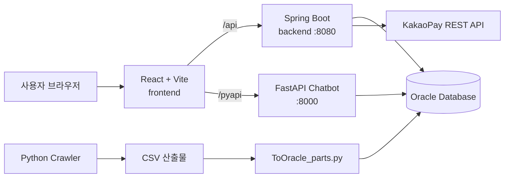
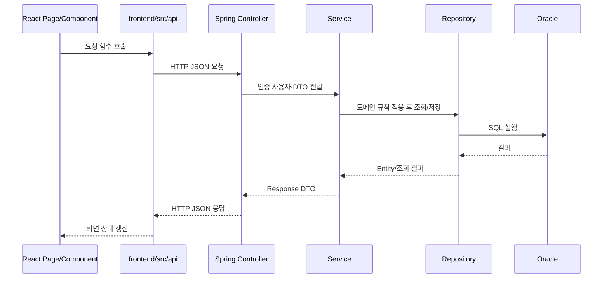

# 전체 구조

| 항목 | 내용 |
| --- | --- |
| 최종 수정일 | 2026-10-26 |
| 담당자 | 소주성, 김장현, 최민석 |

## 시스템 구성



## 저장소 구조

```text
soldesk/
├─ frontend/
│  └─ src/
│     ├─ api/          # 백엔드·챗봇 요청 함수
│     ├─ components/   # 화면 단위 UI
│     ├─ context/      # Cart, Build 상태
│     ├─ hooks/        # 조회·추천·스펙 관련 Hook
│     ├─ layouts/      # MainLayout, Header, Footer
│     ├─ pages/        # Router 페이지
│     └─ styles/       # 토큰·전역 스타일
├─ backend/
│  └─ src/main/java/com/comcheck/comcheck/
│     ├─ config/       # Security, RestClient
│     ├─ domain/       # 도메인별 Controller/Service/Repository/Entity/DTO
│     └─ global/       # 공통 예외 처리
├─ database/           # Oracle DDL, 시퀀스, 보정 SQL
├─ crwaler/pcparts/    # 크롤링·정제·적재 스크립트
└─ chatbot/            # FastAPI 챗봇
```

## Backend 도메인 구조

`domain/` 아래에 다음 모듈이 있습니다.

- `user`: 회원, JWT 로그인, 비밀번호 재설정
- `part`, `partspec`: 부품과 부품 사양
- `estimate`, `estimateitem`: 개인·추천 견적과 품목
- `build`: 호환성·교체 후보 추천
- `cart`, `cartitem`: 회원별 장바구니
- `payment`, `paymentitem`, `paymentcancellation`: 카카오 결제와 스냅샷·취소 이력
- `board`: 게시글, 대표 이미지, 댓글, 좋아요, 카테고리, 조회수

## 일반 요청 흐름



## 인증 흐름

- `UserController`가 로그인 요청을 받고 JWT를 반환합니다.
- `JwtAuthenticationFilter`가 `Authorization: Bearer <token>`을 검증합니다.
- 검증된 사용자 ID는 `Authentication.principal`의 `Long` 값으로 Controller와 Service에 전달됩니다.
- 장바구니·결제·개인 견적·게시글 작성은 URL이나 본문 사용자 ID를 신뢰하지 않고 인증 사용자 ID를 사용합니다.

## 프론트 API 연결 규칙

- 기본 API 주소는 `frontend/src/api/client.js`의 `VITE_API_BASE_URL` 또는 `/api`입니다.
- Vite 개발 프록시는 `frontend/vite.config.js`에 정의되어 있습니다.
- `VITE_USE_MOCK`이 문자열 `'false'`가 아니면 일부 화면은 목업을 사용할 수 있습니다.
- 예산 추천 조회는 `frontend/src/api/estimates.js`에서 목업 여부와 관계없이 실제 API를 사용합니다.


