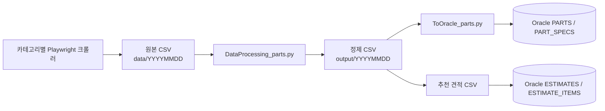

# 크롤링·CSV·Oracle 적재

| 항목 | 내용 |
| --- | --- |
| 최종 수정일 | 2026-10-26 |
| 담당자 | 김주찬, 이혜연 |

## 1. 개요

Playwright 크롤러가 PC 부품 데이터를 수집하고, 정제된 CSV를 Oracle의 `PARTS`, `PART_SPECS`, 추천 견적 테이블에 적재합니다. 적재는 기본적으로 비활성화되어 있습니다.

## 2. 화면/사용자 흐름

이 기능은 사용자 화면 흐름이 아니라 운영 데이터 흐름입니다.

## 3. 관련 API

직접 HTTP API를 제공하지 않습니다. 적재 데이터는 부품·견적 API를 통해 화면에 노출됩니다.

- `GET /api/parts`
- `GET /api/estimates/recommended`
- `GET /api/estimates/recommended/budget`

## 4. 관련 DB 테이블/엔티티

- `PARTS`
- `PART_SPECS`
- `ESTIMATES`
- `ESTIMATE_ITEMS`

## 5. 담당 코드 위치

- `crwaler/pcparts/cpu_playwright.py`
- `crwaler/pcparts/gpu_playwright.py`
- `crwaler/pcparts/ram_playwright.py`
- `crwaler/pcparts/ssd_playwright.py`
- `crwaler/pcparts/psu_playwright.py`
- `crwaler/pcparts/mainboard_playwright.py`
- `crwaler/pcparts/DataProcessing_parts.py`
- `crwaler/pcparts/ToOracle_parts.py`
- `crwaler/pcparts/recommendation_profiles.py`
- `crwaler/pcparts/recommendation_engine.py`

## 6. 주의사항 / 미완성 부분 / TODO

- `ToOracle_parts.py`는 `--execute`가 없으면 DB 쓰기를 수행하지 않습니다.
- 일반 부품·스펙 적재와 추천 견적 적재는 분리되어 있습니다.
- 추천 견적 적재 뒤에는 주석에 안내된 부속 부품 보정 실행 조건을 확인해야 합니다.
- `product_url` 중복이 있으면 적재가 실패할 수 있습니다. 스크립트는 URL 기준으로 기존 부품을 찾습니다.
