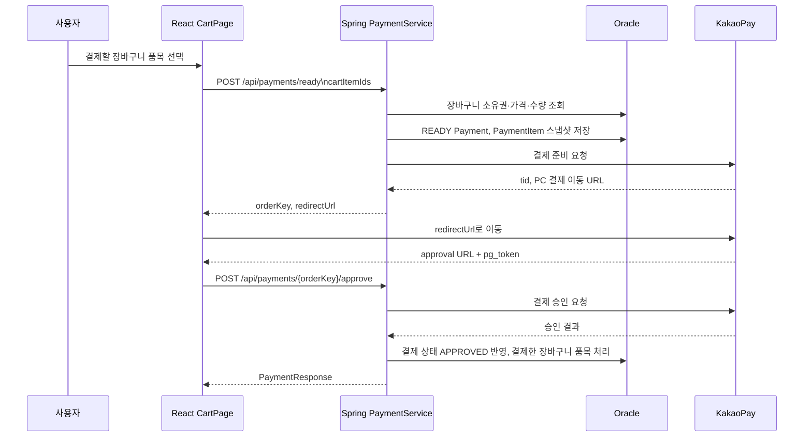

# 카카오 결제

| 항목 | 내용 |
| --- | --- |
| 최종 수정일 | 2026-10-26 |
| 담당자 | 소주성 |

## 1. 개요

선택한 장바구니 품목으로 결제를 준비하고, 카카오페이 인증 후 승인합니다. 결제 시점 품목은 별도 스냅샷으로 저장하며, 결제 이력과 취소 이력을 조회할 수 있습니다.

## 2. 화면/사용자 흐름

## 3. 관련 API

- `POST /api/payments/ready`
- `POST /api/payments/{orderKey}/approve?pg_token=`
- `POST /api/payments/{orderKey}/fail`
- `POST /api/payments/{paymentId}/cancel`
- `GET /api/payments`
- `GET /api/payments/{paymentId}`
- `GET /api/payments/{paymentId}/items`
- `GET /api/payments/{paymentId}/cancellations`

## 4. 관련 DB 테이블/엔티티

- `PAYMENTS` / `domain/payment/entity/Payment.java`
- `PAYMENT_ITEMS` / `domain/paymentitem/entity/PaymentItem.java`
- `PAYMENT_CANCELLATIONS` / `domain/paymentcancellation/entity/PaymentCancellation.java`
- `CARTS`, `CART_ITEMS`, `PARTS`

## 5. 담당 코드 위치

- `backend/src/main/java/com/comcheck/comcheck/domain/payment/controller/PaymentController.java`
- `backend/src/main/java/com/comcheck/comcheck/domain/payment/service/PaymentService.java`
- `backend/src/main/java/com/comcheck/comcheck/domain/payment/client/KakaoPayClient.java`
- `frontend/src/api/payments.js`
- `frontend/src/pages/CartPage.jsx`
- `frontend/src/pages/KakaoPaymentResultPage.jsx`
- `frontend/src/components/payment/PaymentHistoryModal.jsx`

## 6. 주의사항 / 미완성 부분 / TODO

- `KAKAO_PAY_SECRET_KEY`, `KAKAO_PAY_CID` 등 민감 값은 환경 변수로만 관리합니다.
- 프론트가 보내는 것은 `cartItemIds`이며 총금액은 서버가 계산합니다.
- 카카오페이 실제 승인·취소는 개발 키, 승인 URL, 외부 네트워크 설정이 모두 맞아야 합니다.
